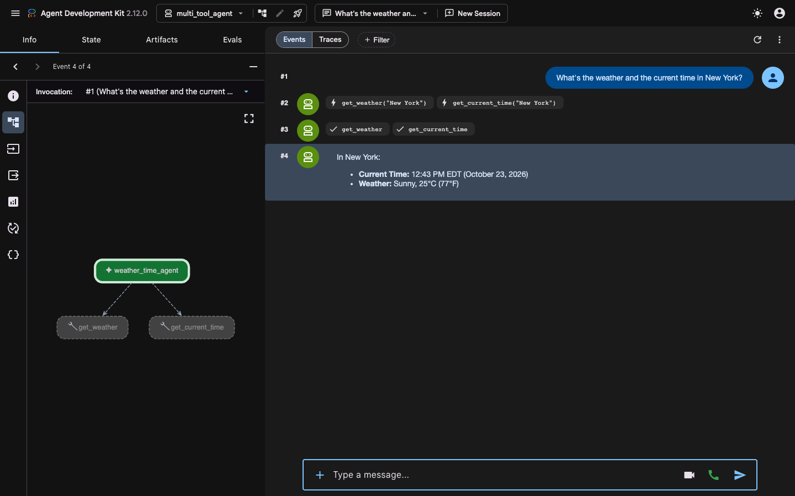
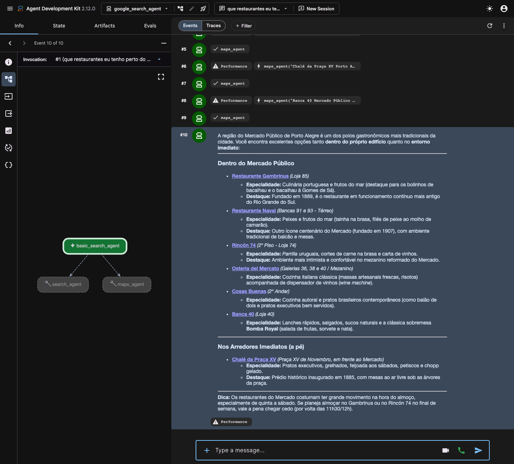

# Desafio Agents

Dois agentes de exemplo construídos com o [Google ADK (Agent Development Kit)](https://google.github.io/adk-docs/) e o Gemini.

| Agente | O que faz | Ferramentas |
|---|---|---|
| `multi_tool_agent` | Responde clima e horário de uma cidade | Funções Python `get_weather` e `get_current_time` |
| `google_search_agent` | Pesquisa na web e encontra lugares | Sub-agentes com `google_search` e `google_maps_grounding` |

## Estrutura

```
desafio_agents/
├── .gitignore
├── README.md
├── print/                    # prints do adk web
├── multi_tool_agent/
│   ├── __init__.py
│   ├── agent.py
│   └── .env                  # chave da API (não vai para o git)
└── google_search_agent/
    ├── __init__.py
    ├── agent.py
    └── .env                  # chave da API (não vai para o git)
```

## Requisitos

- Python 3.10 ou superior (o projeto usa 3.12)
- Uma chave da API do Gemini: https://aistudio.google.com/apikey

## Instalação

```bash
# Python 3.12 via Homebrew (macOS)
brew install python@3.12

# Ambiente virtual
python3.12 -m venv .venv
source .venv/bin/activate

# Dependências
pip install --upgrade pip
pip install google-adk
```

## Configuração

Crie um arquivo `.env` dentro de cada pasta de agente:

```
GOOGLE_GENAI_USE_VERTEXAI=FALSE
GOOGLE_API_KEY=sua_chave_aqui
```

## Como rodar

Na raiz do projeto, com o ambiente virtual ativado:

```bash
source .venv/bin/activate
adk web
```

Abra http://localhost:8000 e escolha o agente no menu do canto superior esquerdo.

Para conversar pelo terminal:

```bash
adk run multi_tool_agent
adk run google_search_agent
```

## Agentes

### multi_tool_agent

Agente com duas funções Python como ferramentas. O modelo decide quando chamá-las a partir do nome, dos tipos e da docstring de cada função. Os dados são fixos e só cobrem **New York**.



### google_search_agent

As ferramentas embutidas `google_search` e `google_maps_grounding` não podem ficar juntas no mesmo agente: a API retorna `400 INVALID_ARGUMENT`. Por isso cada uma fica num sub-agente (`search_agent` e `maps_agent`), e o agente principal usa os dois através de `AgentTool`.

```
basic_search_agent
├── search_agent  → google_search
└── maps_agent    → google_maps_grounding
```



## Observações

- O modelo usado é o `gemini-3.8-flash`. Modelos `*-live` só funcionam por streaming de áudio (microfone no `adk web`) e recusam mensagens digitadas.
- Os arquivos `.env` estão no `.gitignore` e não devem ser versionados.
